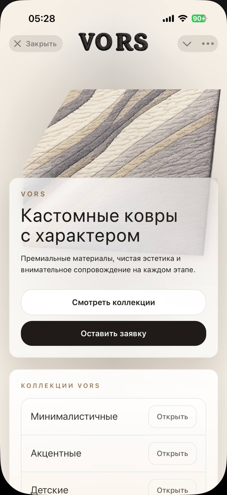
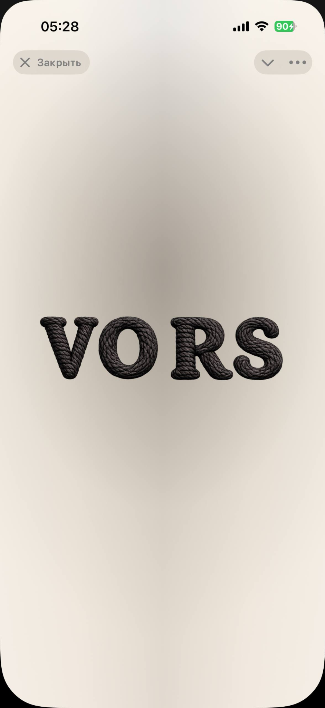
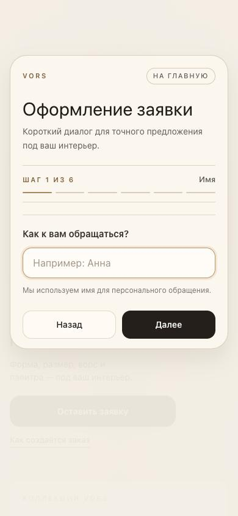
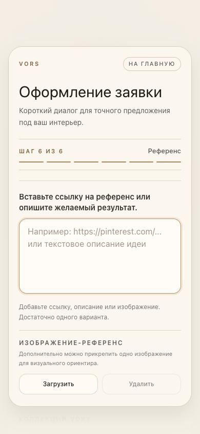
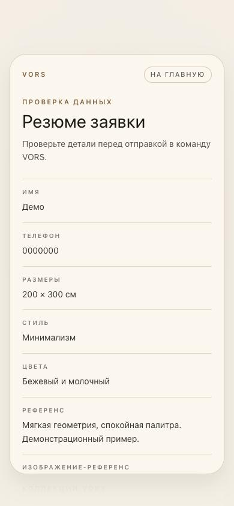

# VORS — Telegram Mini App для индивидуальных ковров

**Мобильный интерфейс для знакомства с коллекциями, оформления индивидуальной заявки и проверки её статуса.**

`Next.js 15` · `React 19` · `TypeScript` · `Tailwind CSS` · `Node.js` · `grammY` · `Supabase REST API`

**Статус:** разрабатываемый MVP. Интерфейс и локальные сборки проверены; сквозная работа с реальными сервисами Telegram и Supabase **ещё не подтверждена**. Это демонстрация текущего состояния проекта, а не завершённый коммерческий запуск.

## Как выглядит приложение

<p align="center">
  
  &nbsp;&nbsp;
  
</p>

<p align="center"><sub>Главный экран и фирменная заставка в интерфейсе Telegram</sub></p>

### Сценарий оформления заявки

В интерфейсе реализована **форма из шести шагов**: переходы между этапами, проверка полей, возврат к предыдущему шагу и сохранение введённых значений во время навигации. Перед отправкой доступно резюме заявки.

<p align="center">
  
  &nbsp;&nbsp;
  
  &nbsp;&nbsp;
  
</p>

На шаге референса предусмотрены ссылка или текстовое описание и элемент для добавления изображения. **Успешная загрузка в реальное хранилище отдельно не проверена.** На снимке резюме использованы только демонстрационные данные.

### Проверка статуса

<p align="center">
  
</p>

Разработан интерфейс ввода номера заявки и обработки состояний ошибок. Сквозное получение статуса существующей заявки через внешние сервисы в этой проверке не подтверждалось.

## Возможности и техническая реализация

- **Главный экран:** анимированное появление бренда, блоки коллекций и вход в сценарий оформления заявки.
- **Многошаговая форма:** шесть этапов, валидация, переходы назад и вперёд, итоговое резюме.
- **Референсы:** поле ссылки или описания и интерфейс выбора изображения.
- **Статус заявки:** отдельное окно поиска и обработка ошибок.
- **Серверная часть:** API-обработчики Next.js для интеграционных сценариев, код обращения к Supabase через REST API и Telegram Bot API.
- **Telegram-бот:** отдельный Node.js/TypeScript-компонент с библиотекой `grammY`.

Наличие интеграционного кода **не означает**, что все сетевые сценарии прошли проверку в реальной среде.

## Архитектура

```text
Пользователь в Telegram / мобильном браузере
                  |
          Next.js + React UI
                  |
          Next.js API routes
             /           \
      Supabase REST    Telegram Bot API

Отдельный Telegram-бот: Node.js + grammY
```

Клиентский интерфейс отделён от серверных обработчиков и кода работы с внешними сервисами. Сборки проверены локально, без рабочих секретов в демонстрационном комплекте.

## Проверки — 15 октября 2026 года

| Проверка | Результат |
|---|---|
| Mini App: `npm run typecheck` | Успешно |
| Mini App: `npm run build` | Успешно |
| Bot: `npx tsc --noEmit -p tsconfig.json` | Успешно |
| Bot: `npm run build` | Успешно |
| Видеогайд: `npm run build` (проверка типов) | Успешно |

В браузере проверены шесть шагов формы, валидация, навигация, сохранение данных между шагами, открытие поиска статуса и обработка ошибок. Проверены основные размеры экранов 320, 390 и 430 px, но реальный Telegram WebView на iOS и Android требует отдельной проверки. Подробности — в [отчёте о проверке](docs/verification-2026-10-15.md).

## Текущие ограничения

- Реальные отправка заявки, загрузка изображения, получение статуса и Telegram-уведомления не подтверждены сквозными проверками.
- Перед использованием с реальными пользователями требуется завершить и проверить серверную защиту Telegram-контекста и надёжность обработки повторных запросов.
- Выявлены отдельные замечания к отображению мобильного интерфейса; ведётся доработка.
- Полноценный каталог, оплата и конфигуратор изделий пока не реализованы.

**Скриншоты:** настоящие снимки локальной сборки от 15.10.2026 с демонстрационными значениями, не макеты. Они включают текущий *незакоммиченный* вариант главного экрана и могут отличаться от последнего коммита приватного репозитория.

**О репозитории:** здесь размещены только публичные демонстрационные материалы. Исходный код и рабочая история разработки VORS хранятся в отдельном приватном репозитории.
